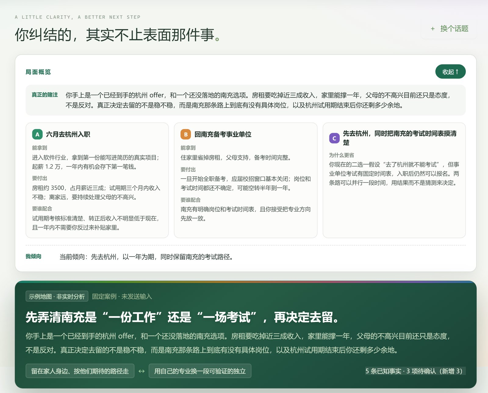
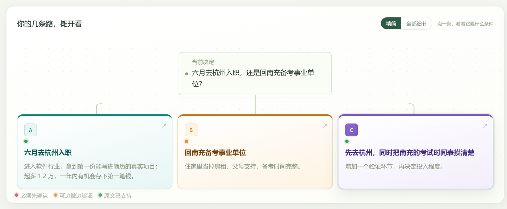
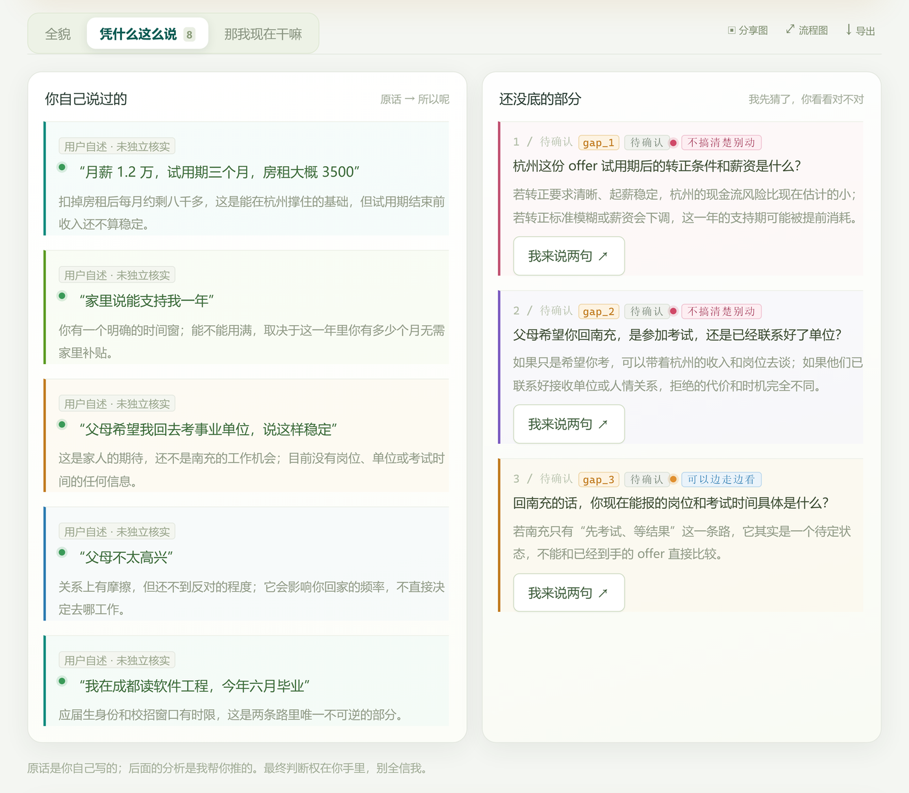
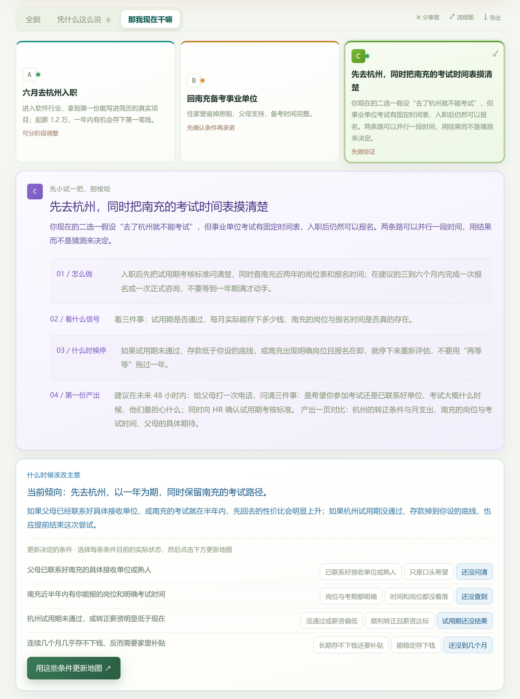
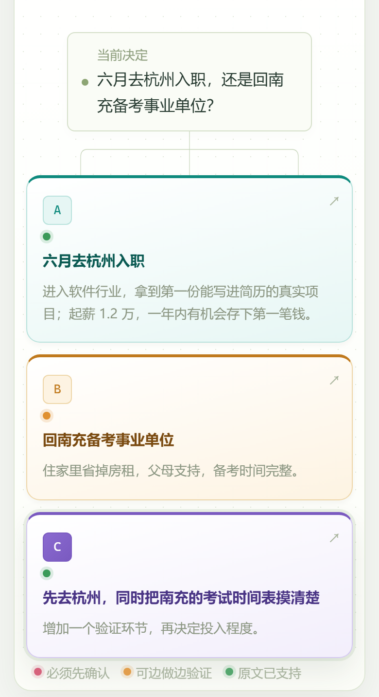

<div align="center">

# 清醒地图 · LucidMap

**把一团乱麻的纠结，摊开成一张能用的图。**

已知事实 → 待确认的缺口 → 三条路各自的条件与代价 → 48 小时内的下一步。

不替你决定，只帮你看清。

[](https://ld007379.github.io/lucidmap/v3/)
[](https://creativecommons.org/licenses/by-nc-sa/4.0/)


[**打开就能用 →**](https://ld007379.github.io/lucidmap/v3/) · 不用注册、不用登录、不用安装

[](https://ld007379.github.io/lucidmap/v3/)

</div>

---

## 为什么做这个

纠结的时候，最容易听到的建议是「看你自己」「两个都有道理」「想清楚再说」。这些话不错，但没帮上忙——它没有把条件摆到桌面上。

直接问 AI 也不一定好：它常常先给结论（去大城市、换工作、分手），然后补一堆理由。可结论对别人成立，对你不一定。它不知道你的房租要吃掉三成收入，不知道家里能撑几个月，不知道这份工作干不下去还能不能回去。**它没问，你也不会想到要说。**

真正卡住人的，通常不是「选 A 还是 B」，而是：

- 「B 到底存不存在？」——选项还没落地，就在脑子里比价；
- 「我凭什么觉得 B 行？」——支撑判断的其实是情绪和别人的故事；
- 「什么时候该认输/改主意？」——没有预先写下的止损条件，只能一路硬扛。

这些都不是打气能解决的，要补事实、要把条件写清楚。

所以这个工具做的事很窄：**不给你答案，把你已知的、你缺的、每条路的代价与成立条件、下一步能验证的小实验，摊在一张图上。**

## 它给你什么

| 产出 | 具体是什么 |
| --- | --- |
| **已知事实** | 只从你自己的描述里提取，逐条附上你的原话；没核实过的标「自述 · 未独立核实」 |
| **待确认的缺口** | 分成「不搞清楚别动」和「可以边走边看」两级，带跨轮次稳定的编号，方便多轮补齐 |
| **三条路** | A / B 各自的收益、代价、**成立条件**、能不能撤回；外加一条不在这两个选项里的「第三条路」 |
| **下一步** | 一个 48 小时内做得完的小实验 + 一份可交付物——不是「再想想」「再努力一点」 |
| **什么情况下该改主意** | 预先写清哪些信号出现时，这张图应该作废重画 |
| **导出** | 分享图 PNG、Mermaid 流程图、Markdown，方便贴进文档或发给朋友讨论 |

支持**多轮更新**：回答缺口、补充条件、记录上一轮行动的真实结果，地图会跟着重算。同一件事可以反复画。

## 三步就用完

1. **写下正在纠结的事**——一段话就行，不用先整理，越具体越好（钱、时间、谁反对、能反悔吗）。
2. **选引擎**——默认「本地规则引擎」，不联网、几十秒出图；也可以填自己的 API Key，措辞更贴合、追问更细。
3. **拿到地图，补上缺口，再画一次**——先看「待确认的缺口」，把能问的问清楚，回来重新出图。


## 报告长什么样

<div align="center">



*首屏：一句话说清你现在的处境，A / B / C 三条路先摆出来*

</div>

| 全貌 | 凭什么这么说 |
| --- | --- |
|  |  |
| **三条路的收益、代价、成立条件** | **每条结论的依据，能追回到你的原话** |

<div align="center">



*「那我现在干嘛」：48 小时内能做完的一步*



*手机上打开同一个链接就行，数据各存各的浏览器*

</div>

## 为什么可信

可信不是因为「AI 很聪明」，而是因为**方法透明、边界清楚**：

1. **原话引用，不改写。** 已知事实只来自你写下的话，逐条附出处。它不替你总结感受，也不替你脑补动机。
2. **不知道就标未知。** 信息不够的时候，它写「待确认」，而不是编一个听起来合理的故事。
3. **条件化，而不是下命令。** 不说「你应该去」，而说「如果 X 成立，A 的代价可控；如果 X 不成立，A 的核心假设就没了」。
4. **可撤回的小实验。** 给你的下一步是「做完会改变判断」的动作，而不是不可逆的一步。先验证，再投入。
5. **改主意的条件也写在报告里。** 一份不写止损条件的地图，只是更精致的自我说服。

**它不是算命，也不替你做决定。** 它不预测结果、不给概率、不承诺「按这个做就能成」；也不替代心理、医疗、法律、财务方面的专业意见。地图是你自己画的，它只负责把纸铺平、把已知的钉子标出来、把空白处指给你看。

## 隐私与成本

- **没有后端。** 页面是纯前端单文件，没有统计脚本、没有第三方追踪、没有账号系统。
- **本地引擎不联网。** 你写的内容不离开浏览器，断网也能用。
- **用 AI 时也不经过本项目的中转。** 请求由你的浏览器直接发给你选的服务商；API Key 存在你自己浏览器的 localStorage 里，本站拿不到、也不收集。
- **成本只有你自己的 API 费用。** 软件免费；用 AI 引擎时按所选服务商的定价计费，费用走你自己的账户，各家用多少付多少，以官网为准。
- **不配 Key 也能用。** 本地规则引擎能出完整结构的地图，只是没有大模型那种贴合你原话的措辞和追问。想先看看长什么样，直接打开示例报告即可。

## 支持的服务商（自带 Key）

| 服务商 | 接口 |
| --- | --- |
| DeepSeek | `api.deepseek.com` |
| 通义千问 | `dashscope.aliyuncs.com`（兼容模式） |
| Kimi / 月之暗面 | `api.moonshot.cn` |
| 硅基流动 | `api.siliconflow.cn` |
| OpenRouter | `openrouter.ai`（一把 Key 调 GPT / Claude / Gemini） |

每家的 Key 和模型分开存，切换不会互相覆盖。为什么不直接接 OpenAI 官方：国内浏览器连 `api.openai.com` 经常超时，OpenRouter 是同一套协议、同一批模型且国内可达，所以用它代替。豆包、智谱的接口不允许浏览器直连（跨域被拦），要接得自己搭代理，暂时没做。

## 快速开始

### 在线（推荐）

| 版本 | 地址 | 适合 |
| --- | --- | --- |
| **v3 新版（推荐）** | https://ld007379.github.io/lucidmap/v3/ | 落地页 + 工作台在同一页；专业版 / 人性版一键切换 |
| 选择页 | https://ld007379.github.io/lucidmap/ | 旧版两套入口 |
| 专业版 | https://ld007379.github.io/lucidmap/pro/ | 措辞克制、术语多、结构密 |
| 人性版 | https://ld007379.github.io/lucidmap/human/ | 口语化、直接、给大众用户 |
| 正式版 v2 | https://ld007379.github.io/lucidmap/v2/ | 内容同上，另带版权与许可声明，对外发布用这个 |

专业版和人性版**能力相同**，区别只在「说话方式」；所有旧版网址长期有效。

### 本地

```bash
git clone https://github.com/ld007379/lucidmap.git
```

然后用浏览器打开对应的 `index.html` 即可。`pro/`、`human/` 是纯单文件，可以单独下载双击；`v3/index.html` 的介绍页截图引用仓库里的 `assets/`，请整仓克隆或整目录部署，想离线分发就用单文件内嵌版。

- **单文件、零依赖**：样式、脚本、Mermaid 渲染组件全部内联，没有构建步骤，不用 `npm install`，断网可打开（AI 引擎除外）。
- **数据在本地**：Key 和草稿存在浏览器 localStorage，换浏览器就是一套新的空白数据，换目录/换盘不影响。

## FAQ

**需要注册或登录吗？**
不需要。没有任何账号系统，打开就能写。

**不配 API Key 能用吗？**
能。本地规则引擎不联网也能出完整结构的地图，适合先看结构；AI 引擎只是让措辞更贴你的原话、追问更细。

**我的事会被上传吗？**
不会。本地引擎完全不联网；用 AI 引擎时，内容由你的浏览器直接发给你选的服务商（受该服务商的隐私政策约束），不经过本项目。

**这是 AI 算命 / 人生建议吗？**
不是。它不给结论、不预测结果。它做的是把事实、缺口、条件、代价、可撤回的下一步摆清楚——判断仍然是你自己做的。

**手机上能用吗？**
能。发个链接给自己，浏览器里打开就行；也可以「添加到主屏幕」当网页应用用。

**换浏览器数据还在吗？**
不在。数据按浏览器存在 localStorage 里，Edge 和 Chrome 是两套。

**能商用吗？**
不能。许可是 CC BY-NC-SA 4.0：需署名、非商业使用、修改后以相同协议共享。

## 版本与更新日志

| 版本 | 时间 | 主要变化 |
| --- | --- | --- |
| **v3.0** | 2026-11 | 新介绍页 + 工作台合在一页：专业版 / 人性版一键切换（`/v3/` 与 `/v3/human/`）；首屏可直接看一份完整示例报告；方法说明写进页面（依据、边界、什么情况下该改主意）；旧版入口全部保留 |
| v2.3.0 | 2026-11 | 专业版 / 人性版最新：多轮更新、导出分享图 PNG / Mermaid / Markdown、支持 OpenRouter；`/v2/` 为带版权水印的正式发布版 |
| v2.x / v1.x | 2026-10 | 早期迭代，已归档，不再发布 |

## 文件结构

```
.
├── index.html          # 选择页：旧版两套入口
├── v3/                 # v3 新版：介绍页 + 工作台（专业版 / 人性版可切换）
│   ├── index.html      # 专业版措辞
│   └── human/index.html# 人性版措辞
├── pro/index.html      # 专业版（单文件）
├── human/index.html    # 人性版（单文件）
├── v2/                 # 正式版：内容同上，另加版权与许可声明
│   ├── index.html
│   ├── pro/index.html
│   ├── human/index.html
│   └── LICENSE
├── assets/             # README 用的截图、封面、演示动图
├── .nojekyll           # 关掉 GitHub Pages 的 Jekyll，直接按静态文件发布
└── README.md
```

## 如何自行修改

每个页面都是**自包含的单文件**，改完直接刷新就能看到效果，不需要任何构建工具。

- **改文案 / 配色 / 追问逻辑**：在对应的 `index.html` 里搜中文关键词，改完保存刷新。
- **加一个服务商**：在服务商配置表里加一条（接口地址 + 预置模型），界面上会自动多一个可选项。
- **部署自己的副本**：fork 之后在仓库 Settings → Pages 里把 Source 设为 `main` / `/ (root)`，网址变成 `https://<你的账号>.github.io/lucidmap/`。
- **改了要发布**：`git add -A && git commit -m "更新" && git push`，Pages 一两分钟后自动生效，网址不变。

修改和再分发请保留原作者署名与 CC BY-NC-SA 4.0 协议——这是许可要求，不是请求。

## License

[CC BY-NC-SA 4.0](https://creativecommons.org/licenses/by-nc-sa/4.0/)（署名 - 非商业性使用 - 相同方式共享 4.0 国际）。

- ✅ 可以免费使用、复制、分享、修改
- ✅ 必须署名 **ld007379**，并附上许可协议链接
- ⛔ 不得用于商业目的
- 🔁 修改后的作品必须以相同协议分享

完整条文见 [v2/LICENSE](v2/LICENSE)。

---

作者：[ld007379](https://github.com/ld007379) · 仓库：https://github.com/ld007379/lucidmap

如果你用它把一件事想清楚了，欢迎回来说一声；如果它哪里没帮上忙，更欢迎[开个 Issue](https://github.com/ld007379/lucidmap/issues) 告诉我——那才是下一版最该改的地方。
