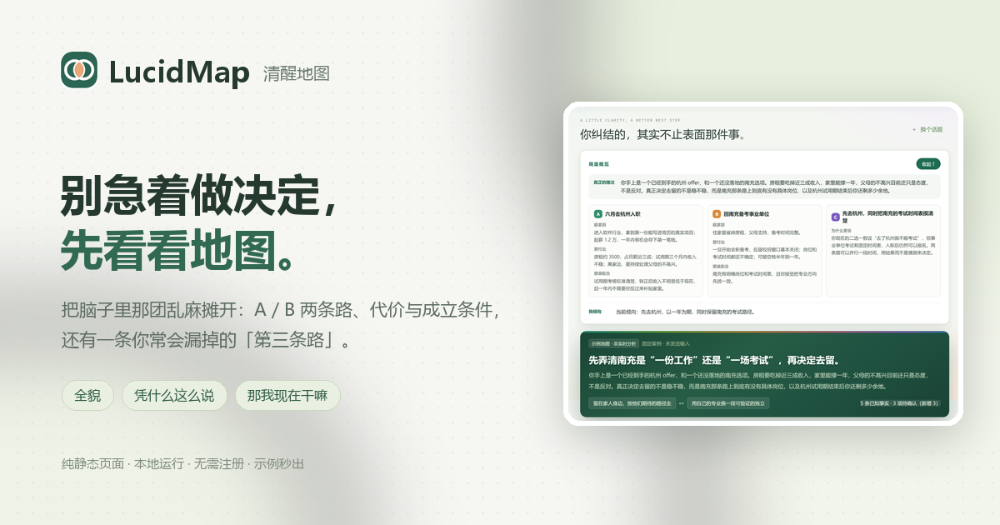
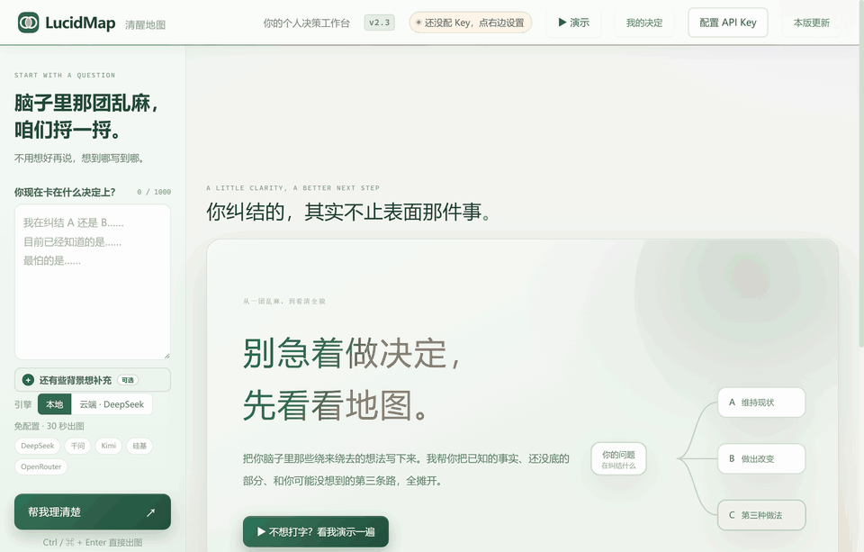

<div align="center">

# 清醒地图 · LucidMap

**把一团乱麻的纠结，摊开成一张能用的图。**

已知事实 → 待确认的缺口 → 三条路各自的条件与代价 → 48 小时内的下一步。

不替你决定，只帮你看清。

[](https://ld007379.github.io/lucidmap/v3/)
[](https://www.apache.org/licenses/LICENSE-2.0)


[**打开就能用 →**](https://ld007379.github.io/lucidmap/v3/) · 不用注册、不用登录、不用安装

[](https://ld007379.github.io/lucidmap/v3/)

</div>

---

## 为什么做这个

纠结的时候，最容易听到的建议是「看你自己」「两个都有道理」「想清楚再说」。这些话不错，但没帮上忙——它没有把条件摆到桌面上。

直接问 AI 也不一定好：它常常先给结论（去大城市、换工作、分手），然后补一堆理由。可结论对别人成立，对你不一定。它不知道你的房租要吃掉三成收入，不知道家里能撑几个月，不知道这份工作干不下去还能不能回去。**它没问，你也不会想到要说。**

真正卡住人的，通常不是「选 A 还是 B」，而是：

- 「B 到底存不存在？」——选项还没落地，就在脑子里比价；
- 「我凭什么觉得 B 行？」——支撑判断的其实是情绪和别人的故事；
- 「什么时候该认输/改主意？」——没有预先写下的止损条件，只能一路硬扛。

这些都不是打气能解决的，要补事实、要把条件写清楚。

所以这个工具做的事很窄：**不给你答案，把你已知的、你缺的、每条路的代价与成立条件、下一步能验证的小实验，摊在一张图上。**

## 它给你什么

| 产出 | 具体是什么 |
| --- | --- |
| **已知事实** | 只从你自己的描述里提取，逐条附上你的原话；没核实过的标「自述 · 未独立核实」 |
| **待确认的缺口** | 分成「不搞清楚别动」和「可以边走边看」两级，带跨轮次稳定的编号，方便多轮补齐 |
| **三条路** | A / B 各自的收益、代价、**成立条件**、能不能撤回；外加一条不在这两个选项里的「第三条路」 |
| **下一步** | 一个 48 小时内做得完的小实验 + 一份可交付物——不是「再想想」「再努力一点」 |
| **什么情况下该改主意** | 预先写清哪些信号出现时，这张图应该作废重画 |
| **导出** | 分享图 PNG、Mermaid 流程图、Markdown，方便贴进文档或发给朋友讨论 |

支持**多轮更新**：回答缺口、补充条件、记录上一轮行动的真实结果，地图会跟着重算。同一件事可以反复画。

## 三步就用完

1. **写下正在纠结的事**——一段话就行，不用先整理，越具体越好（钱、时间、谁反对、能反悔吗）。
2. **选引擎**——默认「本地规则版」，不联网、只做结构整理；简单 A/B 或“要不要”能拆，开放式问题会先让你补选项。复杂问题建议填自己的 API Key 用云端。
3. **拿到地图，补上缺口，再画一次**——先看「待确认的缺口」，把能问的问清楚，回来重新出图。



## 报告长什么样

<div align="center">


*首屏：一句话说清你现在的处境，A / B / C 三条路先摆出来*

</div>

| 全貌 | 凭什么这么说 |
| --- | --- |
|  |  |
| **三条路的收益、代价、成立条件** | **每条结论的依据，能追回到你的原话** |

<div align="center">


*「那我现在干嘛」：48 小时内能做完的一步*


*手机上打开同一个链接就行，数据各存各的浏览器*

</div>

## 为什么可信

可信不是因为「AI 很聪明」，而是因为**方法透明、边界清楚**：

1. **原话引用，不改写。** 已知事实只来自你写下的话，逐条附出处。它不替你总结感受，也不替你脑补动机。
2. **不知道就标未知。** 信息不够的时候，它写「待确认」，而不是编一个听起来合理的故事。
3. **条件化，而不是下命令。** 不说「你应该去」，而说「如果 X 成立，A 的代价可控；如果 X 不成立，A 的核心假设就没了」。
4. **可撤回的小实验。** 给你的下一步是「做完会改变判断」的动作，而不是不可逆的一步。先验证，再投入。
5. **改主意的条件也写在报告里。** 一份不写止损条件的地图，只是更精致的自我说服。

**它不是算命，也不替你做决定。** 它不预测结果、不给概率、不承诺「按这个做就能成」；也不替代心理、医疗、法律、财务方面的专业意见。地图是你自己画的，它只负责把纸铺平、把已知的钉子标出来、把空白处指给你看。

## 隐私与成本

- **没有后端。** 页面是纯前端单文件，没有统计脚本、没有第三方追踪、没有账号系统。
- **本地规则版不联网。** 你写的内容不离开浏览器，断网也能用；它只做结构整理，不是大模型。
- **用 AI 时也不经过本项目的中转。** 请求由你的浏览器直接发给你选的服务商；API Key 存在你自己浏览器的 localStorage 里，本站拿不到、也不收集。
- **成本只有你自己的 API 费用。** 软件免费；用 AI 引擎时按所选服务商的定价计费，费用走你自己的账户，各家用多少付多少，以官网为准。
- **不配 Key 也能用。** 本地规则版会按题型做结构拆解，但不会像大模型那样理解开放式问题；遇到没有明确 A/B 的问题，它会先让你补选项，而不是硬编。复杂问题建议配 Key 用云端。

## 支持的服务商（自带 Key）

| 服务商 | 接口 |
| --- | --- |
| DeepSeek | `api.deepseek.com` |
| 通义千问 | `dashscope.aliyuncs.com`（兼容模式） |
| Kimi / 月之暗面 | `api.moonshot.cn` |
| 硅基流动 | `api.siliconflow.cn` |
| OpenRouter | `openrouter.ai`（一把 Key 调 GPT-6.2 / Claude 5.5 / Gemini 3.8） |

每家的 Key 和模型分开存，切换不会互相覆盖。为什么不直接接 OpenAI 官方：国内浏览器连 `api.openai.com` 经常超时，OpenRouter 是同一套协议、同一批模型且国内可达，所以用它代替。豆包、智谱的接口不允许浏览器直连（跨域被拦），要接得自己搭代理，暂时没做。

> 通义默认已切到 **Qwen4-Max**（API 模型名 `qwen4-max`，2026-11 发布）；想控制成本可在模型 chip 里切回 `qwen3.8-flash`。中小尺寸 Qwen4 模型上线后，点「刷新模型列表」即可看到。
>
> OpenRouter 预置已更新到 **GPT-6.2 Astra / Sol**、GPT-6.1 Terra / Sol、GPT-6 系列，以及 Claude Sonnet 5.5、Gemini 3.8 Flash；旧 GPT-5 默认隐藏，需要可在输入框手打。

### 怎么确认 Key 和模型能用

- 粘贴 Key 后点「**测试连接**」：会真的发一个 `max_tokens=1` 的请求，验证 Key、当前模型名和账户余额，不是只检查格式。
- 模型名会随平台更新：点「**刷新模型列表**」从服务商的 `/models` 接口拉当前可用模型，再点一个模型测试；拉取失败就手动输入官方文档里的模型名。
- 刷新会优先按服务商返回的创建时间排最新，并默认隐藏明显过时的模型（如 qwen-plus、moonshot-v1、deepseek-chat）；需要旧模型时直接在输入框手打名字，仍可测试使用。
- 每家 Key 分开存；「测试连接」只验证**当前选中的模型**。换模型后再测一次，避免模型名过期或没有权限。

## 快速开始

### 在线（推荐）

| 版本 | 地址 | 说明 |
| --- | --- | --- |
| **v3 主站（推荐先看）** | https://ld007379.github.io/lucidmap/v3/ | 选择页：这工具是干什么的 + 一份示例报告，先选「专业版 / 人性版」再进去 |
| v3 手机版 / PWA | https://ld007379.github.io/lucidmap/v3/m/ | 手机入口：直接进工作台，可安装到桌面、支持离线 |
| v3 专业版 | https://ld007379.github.io/lucidmap/v3/pro/ | 介绍页 + 工作台，措辞克制、结构密 |
| v3 人性版 | https://ld007379.github.io/lucidmap/v3/human/ | 介绍页 + 工作台，口语、直接 |

v3 的专业版和人性版**能力完全相同**，区别只在「说话方式」；进去以后顶部可以随时换另一个版本，也能回主站重新选。旧版入口已下线，旧网址会自动跳转到 v3。

### 手机 / 安装到桌面

手机打开 <https://ld007379.github.io/lucidmap/v3/m/>：

- **iPhone**：Safari → 分享 → 添加到主屏幕
- **Android**：Chrome → 菜单 → 安装应用 / 添加到主屏幕

安装后从主屏幕图标打开，会以独立窗口运行；首次打开需要联网，之后本地规则版可以离线使用。注意：主屏幕应用与浏览器可能使用不同的本地存储，建议在主屏幕应用里再配置一次 API Key。

### 本地

```bash
git clone https://github.com/ld007379/lucidmap.git
```

然后用浏览器打开对应的 `index.html` 即可。注意：**v3 页面（`v3/index.html`、`v3/pro/index.html`、`v3/human/index.html`、`v3/m/index.html`）都引用仓库里的 `assets/` 和 PWA 文件**，要整仓克隆或整目录部署，只拷一个 HTML 会缺介绍页的图和安装能力（工作台本身仍能用）；旧版入口已改为跳转页，不再提供旧版工作台。

- **单文件、零依赖**：应用本体（样式、脚本、Mermaid 渲染组件）全部内联，没有构建步骤，不用 `npm install`，断网可打开（AI 引擎除外）。
- **数据在本地**：Key 和草稿存在浏览器 localStorage，换浏览器就是一套新的空白数据，换目录/换盘不影响。

## FAQ

**需要注册或登录吗？**
不需要。没有任何账号系统，打开就能写。

**不配 API Key 能用吗？**
能。本地规则版按题型做结构整理，适合简单的 A/B 或“要不要”；开放式问题它会提示先补一个能比较的选择，不会硬编。AI 引擎则能直接读完整原话、追问更细。

**我的事会被上传吗？**
不会。本地规则版完全不联网；用 AI 引擎时，内容由你的浏览器直接发给你选的服务商（受该服务商的隐私政策约束），不经过本项目。

**这是 AI 算命 / 人生建议吗？**
不是。它不给结论、不预测结果。它做的是把事实、缺口、条件、代价、可撤回的下一步摆清楚——判断仍然是你自己做的。

**手机上能用吗？**
能。发个链接给自己，浏览器里打开就行；也可以「添加到主屏幕」当网页应用用。

**换浏览器数据还在吗？**
不在。数据按浏览器存在 localStorage 里，Edge 和 Chrome 是两套。

**能商用吗？**
能。许可是 Apache-2.0，OSI 认证的正牌开源协议：使用、修改、分发、商用、闭源集成都可以，代价是必须保留版权声明与 [`NOTICE`](NOTICE)、并说明你改了什么。唯一不能用的是名字——「清醒地图」「LucidMap」和图标不在授权范围内，见 [`TRADEMARK.md`](TRADEMARK.md)。

**那别人抄一个一模一样的去卖怎么办？**
拦不住，也不该拦——这正是开源允许的事。能拦的是两件：抹掉你的署名（违反许可=侵犯版权，可以要求 GitHub 下架），和用你的名字招人（商标权，不随代码授权）。如果你的底线是"一行代码都不许被拿去赚钱"，那就不该开源，应该换成 [PolyForm Noncommercial](https://polyformproject.org/licenses/noncommercial/1.0.0/) 这类 source-available 协议。

## 版本与更新日志

| 版本 | 时间 | 主要变化 |
| --- | --- | --- |
| 许可变更 | 2026-11 | 从 CC BY-NC-SA 4.0 换为 **Apache-2.0**：正式成为 OSI 认证的开源项目，开放商用；新增 `NOTICE` 与 `TRADEMARK.md`，把"必须署名"和"名字不能用"两条写成可执行的条款 |
| 手机版 / PWA | 2026-11-21 | 新增 `/v3/m/` 手机入口、`manifest.json`、`sw.js` 离线缓存、安装到桌面；旧版入口统一跳转 v3 |
| **v3.0** | 2026-11 | v3 主站是选择页：先选「专业版 / 人性版」，再进各自的介绍页 + 工作台（`/v3/` → `/v3/pro/`、`/v3/human/`）；两版能力相同、随时切换；首屏可直接看一份完整示例报告；方法说明写进页面（依据、边界、什么情况下该改主意）；旧版入口已下线，旧网址统一跳转 v3 |
| v2.3.0 | 2026-11 | 专业版 / 人性版最新：多轮更新、导出分享图 PNG / Mermaid / Markdown、支持 OpenRouter；`/v2/` 为带版权水印的正式发布版 |
| v2.x / v1.x | 2026-10 | 早期迭代，已归档，不再发布 |

## 文件结构

```
.
├── index.html          # 旧入口：自动跳转到 /v3/
├── v3/                 # v3 新版
│   ├── index.html      # 主站选择页：先选专业版 / 人性版
│   ├── m/index.html    # 手机入口 / PWA 启动页
│   ├── pro/index.html  # 专业版：介绍页 + 工作台
│   └── human/index.html# 人性版：介绍页 + 工作台
├── pro/index.html      # 旧入口：自动跳转到 /v3/pro/
├── human/index.html    # 旧入口：自动跳转到 /v3/human/
├── v2/                 # 旧入口：自动跳转到 /v3/（不再提供旧版内容）
│   ├── index.html
│   ├── pro/index.html
│   └── human/index.html
├── manifest.json       # PWA manifest
├── sw.js               # PWA service worker（离线缓存）
├── 404.html            # 未知路径：跳转到 /v3/
├── assets/             # 截图、封面、演示动图、PWA 图标
├── LICENSE             # Apache License 2.0 全文
├── NOTICE              # 版权归属 + 第三方组件声明（Mermaid / MIT）
├── TRADEMARK.md        # 名称与 Logo 的使用边界
├── .nojekyll           # 关掉 GitHub Pages 的 Jekyll，直接按静态文件发布
└── README.md
```

## 如何自行修改

页面都是 HTML，改完直接刷新就能看到效果，不需要任何构建工具。v3 的介绍页截图是 `assets/` 外链，本地要整仓查看才有图；工作台本身仍在一个文件里。

- **改文案 / 配色 / 追问逻辑**：在对应的 `index.html` 里搜中文关键词，改完保存刷新。
- **加一个服务商**：在服务商配置表里加一条（接口地址 + 预置模型），界面上会自动多一个可选项。
- **部署自己的副本**：fork 之后在仓库 Settings → Pages 里把 Source 设为 `main` / `/ (root)`，网址变成 `https://<你的账号>.github.io/lucidmap/`。v3 页面都引用仓库 `assets/`，整仓部署即可，别只拷单个 HTML。
- **改 PWA / 离线缓存**：`manifest.json` 管安装信息，`sw.js` 管离线缓存；改了页面后把 `sw.js` 里的 `CACHE` 版本号加一，用户下次打开会更新缓存。
- **改了要发布**：`git add -A && git commit -m "更新" && git push`，Pages 一两分钟后自动生效，网址不变。

修改和再分发请保留原作者署名与 [`NOTICE`](NOTICE) 文件，并说明你改了什么——这是 Apache-2.0 的许可要求，不是请求。

## License

代码、文案与图形素材统一采用 [Apache License 2.0](https://www.apache.org/licenses/LICENSE-2.0) 授权——OSI 认证的开源协议。

- ✅ 可以商用、复制、修改、分发、私有化部署
- ✅ 可以闭源使用，不必公开你的修改
- ✅ 附赠明确的专利授权（第 3 条），这是它比 MIT 更适合企业场景的原因
- 📌 **必须**保留版权声明与 [`NOTICE`](NOTICE)，并标注你做了哪些修改
- 📌 **不得**用「清醒地图」「LucidMap」名称与图标给你的版本命名或背书

去掉原作者署名、或换个名字冒充原创，属于违反许可（进而构成版权侵权），可以依法追责并要求 GitHub 下架。名称与 Logo 另有商标权，不随代码一起授权，详见 [`TRADEMARK.md`](TRADEMARK.md)。

完整条文见 [LICENSE](LICENSE)。

---

作者：[ld007379](https://github.com/ld007379) · 仓库：https://github.com/ld007379/lucidmap

如果你用它把一件事想清楚了，欢迎回来说一声；如果它哪里没帮上忙，更欢迎[开个 Issue](https://github.com/ld007379/lucidmap/issues) 告诉我——那才是下一版最该改的地方。
